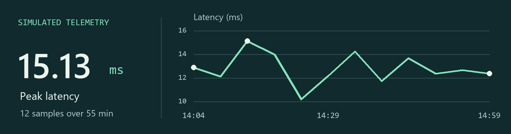

# NC-s

I build interactive dashboards with Python and TypeScript. Two questions behind my projects are how quickly a trading system responds and where crashes cluster on New York City streets.

[繁體中文](https://github.com/NC-s/NC-s/blob/profile/README.zh-Hant.md)

## Trading system telemetry

A Python generator simulates activity across four trading services. An Express API serves the samples to a Vue dashboard, where you can follow latency over time and compare throughput by service.

[Run the dashboard](https://github.com/NC-s/Full-Stack-Website-with-Vue-React-and-D3.js-or-Chart.js#getting-started) · [Read the data pipeline](https://github.com/NC-s/Full-Stack-Website-with-Vue-React-and-D3.js-or-Chart.js/blob/main/server/data_pipeline.py) · [View the plotted sample](https://github.com/NC-s/Full-Stack-Website-with-Vue-React-and-D3.js-or-Chart.js/blob/e734b8268ec5f99879f708d8fed16faa0cc78f03/server/data/metrics.json)

## More projects

| Project | What you can explore |
| --- | --- |
| [Airline sentiment](https://github.com/NC-s/Streamlit-Python-02) | Compare positive and negative tweets by airline, then pick an hour to see where passengers posted. [Dashboard screenshot](https://github.com/NC-s/Streamlit-Python-02/blob/main/pic/example_1.png) |
| [NYC traffic collisions](https://github.com/NC-s/Streamlit-Python-01) | Filter crashes by the number of people injured, or pick an hour to explore collisions on a map. [Streamlit app code](https://github.com/NC-s/Streamlit-Python-01/blob/main/app.py) |
