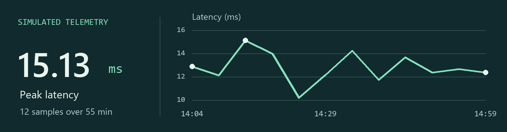

# NC-s

我用 Python 和 TypeScript 做互動式儀表板。我喜歡從具體的問題開始：交易系統的延遲在哪一刻升高？紐約的交通事故集中在哪些街區？

[English](https://github.com/NC-s/NC-s/blob/profile/README.md)

## 交易系統監控

我用 Python 模擬四個交易服務的運作，再透過 Express API 把資料送到 Vue 儀表板。你可以沿著時間軸觀察延遲，也可以比較各服務每秒處理的訊息數。

[在本機執行儀表板](https://github.com/NC-s/Full-Stack-Website-with-Vue-React-and-D3.js-or-Chart.js#getting-started) · [查看資料產生程式](https://github.com/NC-s/Full-Stack-Website-with-Vue-React-and-D3.js-or-Chart.js/blob/main/server/data_pipeline.py) · [查看圖中的數據](https://github.com/NC-s/Full-Stack-Website-with-Vue-React-and-D3.js-or-Chart.js/blob/e734b8268ec5f99879f708d8fed16faa0cc78f03/server/data/metrics.json)

## 其他作品

| 專案 | 可以探索什麼 |
| --- | --- |
| [航空旅客推文分析](https://github.com/NC-s/Streamlit-Python-02) | 比較不同航空公司的正負評推文，再選一個時段，看旅客從哪些地方發文。[介面截圖](https://github.com/NC-s/Streamlit-Python-02/blob/main/pic/example_1.png) |
| [紐約交通事故地圖](https://github.com/NC-s/Streamlit-Python-01) | 依受傷人數篩選事故，或指定一個小時，在地圖上查看事故分布。[Streamlit 程式碼](https://github.com/NC-s/Streamlit-Python-01/blob/main/app.py) |
